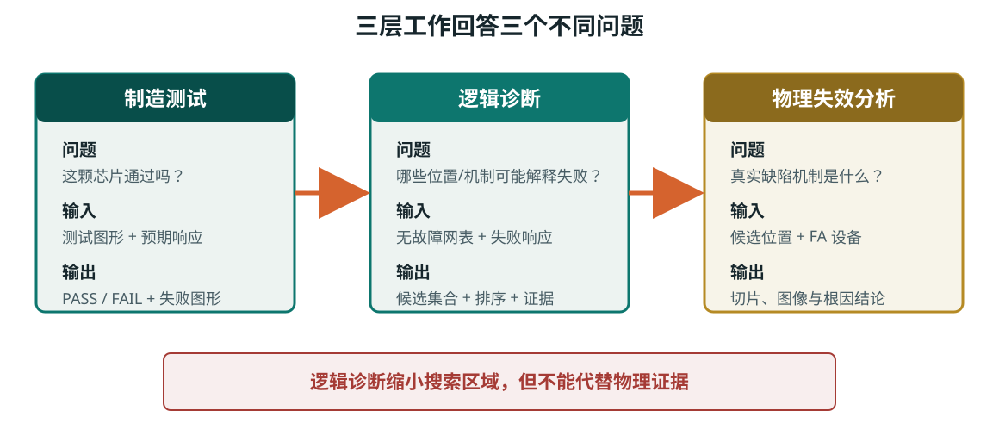
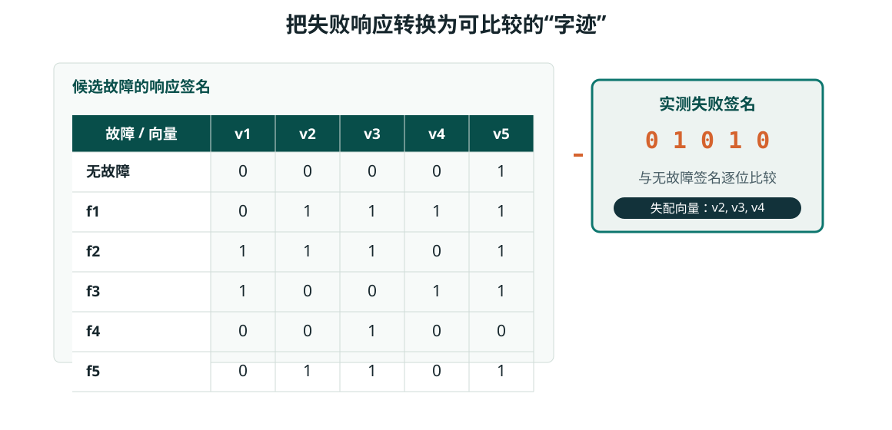
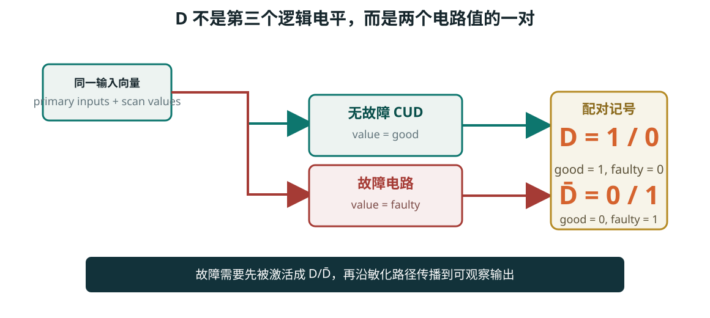
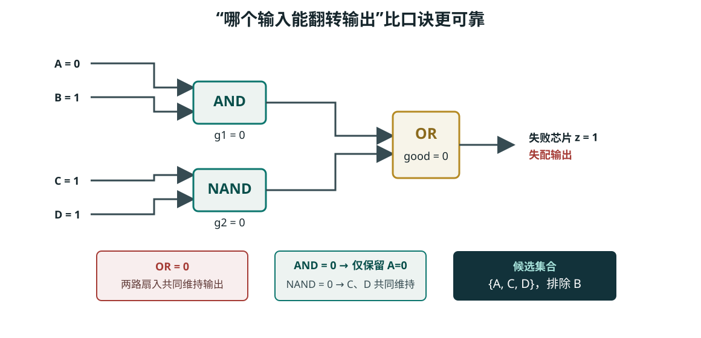
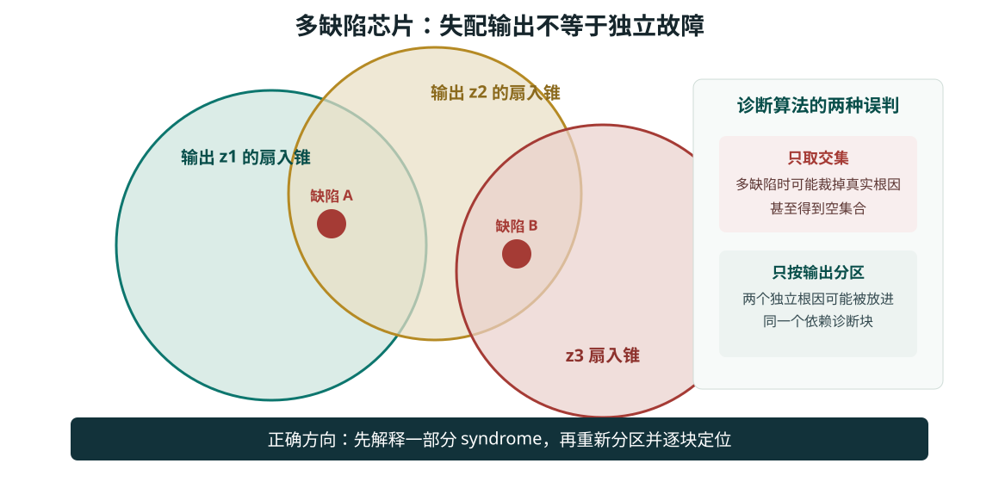
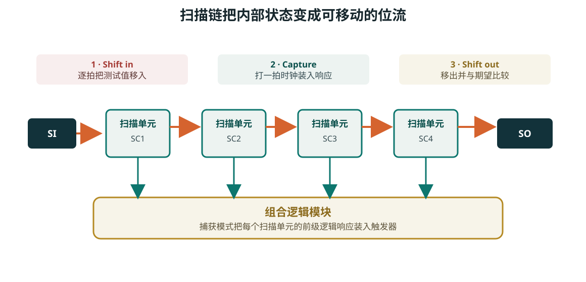
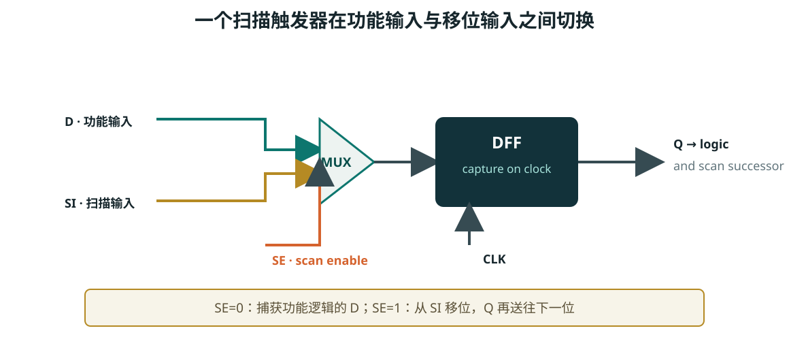
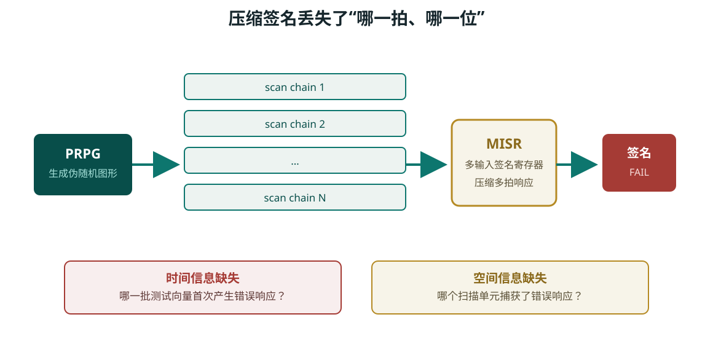
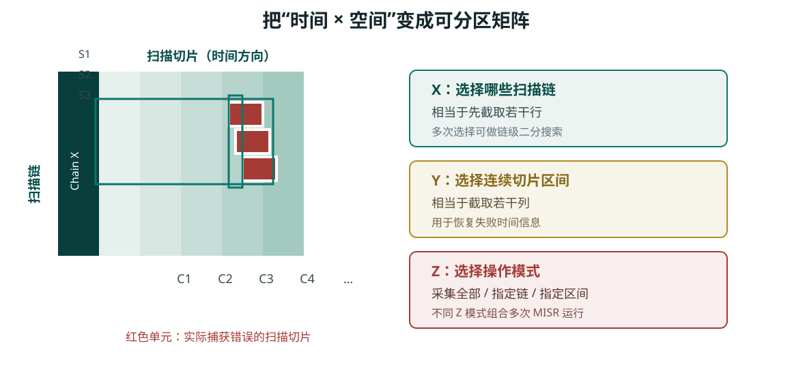

<!-- _class: lead -->
<!-- _header: '' -->
<!-- _footer: '' -->

# 逻辑诊断

## 从一条失败工单，走向可复核的缺陷候选

  故事驱动
  因果关系
  候选排序
  扫描链
  BIST 诊断

3 × 45 分钟纯理论课堂 · 3 个独立工程故事 · [1] 第 7 章

理论依据：[1] 第 7 章，印刷页 397–450

<!--
本章按三节独立故事重写。每节都回答一个完整工程问题，但共同使用“故事—概念—机制—手算—边界—离堂题”模板。
-->

---

# 测试只给出“坏”，诊断还要回答“为什么坏、先查哪里”

  

    01
    <h3>低良率批次</h3>
    
只剩 3 个失效分析名额，怎样从一整批失败芯片中挑出最值得切片的样品？

  

  

    02
    <h3>客户退片</h3>
    
故障字典没有命中，而且芯片可能有两个缺陷，怎样保留并排序竞争原因？

  

  

    03
    <h3>首硅扫描链</h3>
    
逻辑测试失败但异常沿扫描链传播，压缩 BIST 又只剩签名，怎样恢复位置与时间？

  

三节课不是三个算法清单，而是三种诊断现场。每个现场都要交付一份能交给物理失效分析工程师的候选报告。

---

<!-- _class: dense -->

# 每节课使用同一张教学模板

  
<strong>1 · 工单 0–5′</strong>先出现一个必须做决定的生产或调试问题。

  
<strong>2 · 概念 5–15′</strong>只引入解决该问题需要的对象、定义和图。

  
<strong>3 · 机制 15–24′</strong>把一个算法拆成可以口头复述的状态转换。

  
<strong>4 · 手算 24–34′</strong>用小型响应表、位流或候选表走完一次。

  
<strong>5 · 边界 34–40′</strong>说明方法何时失效，以及报告不能证明什么。

  
<strong>6 · 离堂 40–45′</strong>完成一道迁移题，并留下通往下一课的问题。

  课堂节奏
  每节课 = 一个故事 + 一张核心图 + 一次手算 + 一个可复核结论

---

# 一张图看懂本章三节课

  
失败响应

  
候选生成

  
候选排序

  
信息恢复

  
物理核验

  

    <h3>第一课 · 原因到结果</h3>
    
预先模拟故障，用故障字典把真实失败签名映射到候选故障。

  

  

    <h3>第二课 · 结果到原因</h3>
    
从失配输出反推扇入锥，再通过注入、排序和分区解释多缺陷。

  

  

    <h3>第三课 · 恢复观测</h3>
    
扫描链和 BIST 压缩了时间或空间信息，诊断要重新把这些信息找回来。

  

[1] 7.1–7.5 节，印刷页 397–450

---

# 先校准四个词：缺陷、故障、错误、失效

  
<strong>缺陷</strong>硅片上的物理异常：颗粒、开路、短路、薄弱氧化层。

  
<strong>故障</strong>为推理而建立的行为模型：固定型、桥接、延迟等。

  
<strong>错误</strong>故障被激活后，某个信号或状态偏离正确值。

  
<strong>失效</strong>错误传播到可观察输出，使功能或规格不满足。

诊断工具通常输出<strong>逻辑候选</strong>，不是物理缺陷本身。物理原因仍需要切片、显微成像和材料分析确认。

概念链依据：[1] 7.1 节，印刷页 397–400

---

# 三层工作不能混为一谈

  <figure>
    
  </figure>
  

    <h3>如何读图</h3>
    <ul>
      <li>测试回答“是否通过”。</li>
      <li>诊断回答“哪些模型内位置能解释失败”。</li>
      <li>物理失效分析回答“硅片里真正发生了什么”。</li>
    </ul>
    
越往右，证据越接近物理事实，但检查和设备成本也越高。

  

---

# 诊断输出必须写成“候选 + 排名 + 证据边界”

  

    <h3>一份不可用的报告</h3>
    
“问题在扫描链附近。”

    
没有具体候选、没有失败向量、没有排名依据，也没有说明模型遗漏。

  

  

    <h3>一份可复核的报告</h3>
    
候选 `{C17, DFF_42, net_183}`；按可修复向量排序；列出支持的测试向量、未解释输出和可能遗漏的桥接/多缺陷。

  

本章所有方法都围绕同一件事：把“可能是哪里”变成可检查、可比较、可反驳的证据。

---

<!-- _class: divider -->
<!-- _header: '' -->

# 第一节课 · 45 分钟

## 低良率批次中的首片定位

从测试判定、失败签名到故障字典与诊断分辨率。

---

# 工单 1：三片失效分析名额该给谁？

  

    Scene 01 · Wafer Sort Room
    <blockquote>“Lot L23 的良率从 91% 掉到 68%。测试机只告诉我们哪些 die 失败，我们却只有三个切片名额。”</blockquote>
    
交付物不是一句“可能短路”，而是一份候选位置排序，帮助 FA 工程师先检查最有把握的区域。

  

  

    
<strong>已知</strong>无故障门级网表、ATE 测试图形、失败芯片的实际响应。

    
<strong>未知</strong>真实物理缺陷位置、缺陷机制、是否存在多个根因。

    
<strong>约束</strong>FA 时间昂贵；算法必须在一夜内缩小搜索区域。

  

<!--
本课先不讨论复杂现场。学生只需要回答：从黑箱失败数据到少量候选，第一层工具是什么。
-->

---

# 测试判定和逻辑诊断的输入、输出不同

  

    <h3>制造测试</h3>
    <ul>
      <li>输入：测试向量、故障模型、期望响应。</li>
      <li>输出：PASS / FAIL、失败向量、失配输出。</li>
      <li>目标：筛掉坏片，控制逃逸。</li>
      <li>成功标准：高覆盖率、低测试成本。</li>
    </ul>
  

  

    <h3>逻辑诊断</h3>
    <ul>
      <li>输入：无故障模型、失败芯片响应、已有测试集。</li>
      <li>输出：逻辑位置、故障类型候选及排序。</li>
      <li>目标：指导 FA、设计调试和良率提升。</li>
      <li>成功标准：定位质量、候选数量、运行时间。</li>
    </ul>
  

同一条测试向量既能用于判定，也能成为诊断证据；区别在问题是“是否失败”还是“为什么失败”。

[1] 7.1 节，印刷页 397–401

---

# 诊断比较的是一对模型/芯片输出

  Definition 7.1 · Output Pair
  <strong>输出对 (zC, zF)</strong>
  
<code>C</code> 表示 circuit under diagnosis 的无故障模型，<code>F</code> 表示真实失败芯片。相同输入下，对应输出组成一对。

  Definition 7.2 · Failing Test Vector
  <strong>失败测试向量</strong>
  
只要某个输出对出现不一致，该测试向量就是失败向量；产生不一致的输出称为失配输出。

失败芯片内部不可直接读取。诊断只能在无故障网表和外部响应之间推理，因此结论始终带模型边界。

[1] Definitions 7.1–7.3，印刷页 400 与 406

---

# 一个芯片的“字迹”是整组失配响应

  Syndrome
  对每个失败向量 vi，记录哪些输出失配以及失配值

  

    <h3>最完整</h3>
    
保存每个向量、每个输出的实际值。信息最多，存储也最大。

  

  

    <h3>较常用</h3>
    
保存每个向量、每个失配输出的位型。保留空间区分能力。

  

  

    <h3>最压缩</h3>
    
每个向量只保留通过/失败。查询更快，但可能合并不同候选。

  

诊断算法的第一项选择，不是算法名字，而是：你把芯片的哪些“字迹”保留下来了？

---

# 无故障基线、失败向量与通过向量都属于证据

  

    <h3>无故障基线 zC</h3>
    
由无故障模型在相同输入下仿真得到。它是所有比较的参照，不是“实际硅片一定正确”的证明。

  

  

    <h3>失败向量</h3>
    
至少一个输出对出现不一致的向量。失败向量定义的是观测事件，不等同于某个故障已经存在。

  

  

    <h3>通过向量</h3>
    
没有输出失配，但可排除会在该向量上产生新失配的候选，因此必须参与候选筛选。

  

  失配输出
  zC(v) ≠ zF(v) 说明该输出对在该向量下失配

[1] 7.1 节，Definitions 7.1–7.3，印刷页 400、406

---

# 诊断质量不是单一分数

| 指标 | 回答的问题 | 可能的误导 |
|---|---|---|
| 诊断分辨率 | 报告了多少候选？ | 候选少，但可能全部漏掉真实位置；对纯排名列表没有意义 |
| 首次命中 | 第一个真实缺陷出现在排名第几？ | 只对带排名工具有意义 |
| Top-N 命中 | 前 N 个候选中命中多少个真实缺陷？ | 多缺陷芯片要按根因数评价 |
| 成功率 | 物理检查一次能命中多少芯片？ | 与允许检查时间和资源有关 |
| 运行时间 | 是否能在生产决策周期内完成？ | 快但定位不准没有工程价值 |

  候选集合型工具
  Diagnostic resolution R = |C|，C 为候选集合

若工具只输出完整排名而不输出候选集合，分辨率没有直接定义；应改用首次命中与 Top-N 命中。

[1] 7.1 节，印刷页 400–401

---

# “候选小”与“诊断准”是两件事

  

    <h3>很窄但错误</h3>
    
工具每次都只报告 1 个候选，但真实缺陷很少落在这个候选里。

    
<strong>分辨率 = 1，准确性很差。</strong>

  

  

    <h3>较宽但可靠</h3>
    
工具报告 8 个候选，前三个覆盖大多数真实位置，并给出未解释证据。

    
<strong>分辨率不是 1，但 FA 队列更有用。</strong>

  

评价诊断工具要同时问：候选是否包含真实根因？排名是否有用？遗漏风险如何表达？

---

# 故障字典：先模拟“所有可能的原因”

  
故障集合 F

  
测试向量 V

  
故障仿真

  
响应签名

  
失败芯片查表

  

    <h3>优点</h3>
    
字典预先建立，单颗芯片查询快；适合固定型故障占主导、设计和测试集相对稳定的量产阶段。

  

  

    <h3>代价</h3>
    
网表或测试集改变可能需要重建；字典只能解释已经建模的故障。

  

[1] 7.2.1 节，印刷页 401–405

---

# 字典有两个时间尺度：离线构建，在线查询

  

    <h3>离线阶段</h3>
    <ul>
      <li>固定 CUD、故障模型和测试集。</li>
      <li>对每个建模故障执行故障仿真。</li>
      <li>保存响应签名或构建诊断树。</li>
      <li>成本主要是一次性的仿真时间和存储。</li>
    </ul>
  

  

    <h3>在线阶段</h3>
    <ul>
      <li>输入一颗失败芯片的观测 syndrome。</li>
      <li>沿字典或诊断树匹配候选。</li>
      <li>输出候选集合或排名。</li>
      <li>成本主要是查询和后续分析。</li>
    </ul>
  

离线字典不会自动适配网表、测试集或压缩结构的变化。变化后必须重建或重新验证。

[1] 7.2.1 节，印刷页 401–403

---

# 故障字典的基本规模

  完整响应字典
  |D| = O(F × V × Obits)

  
<h3>F</h3><strong>故障数</strong>
故障点 × 每点故障类型。

  
<h3>V</h3><strong>测试向量数</strong>
失败与未失败向量都可能参与区分。

  
<h3>O</h3><strong>可观察位数</strong>
主输出与伪输出都计入。

全扫描把内部节点变成伪输出，但输出位数增加后，完整字典可能比想象中更大。

[1] 7.2.1 节，印刷页 401–403

---

# 把候选签名排成矩阵

  <figure>
    
  </figure>
  

    <h3>如何读图</h3>
    <ul>
      <li>每一行是一个候选故障在全部向量下的响应。</li>
      <li>第一行是无故障基线，不是候选。</li>
      <li>失败芯片得到一行实测签名，与候选行比较。</li>
    </ul>
    
诊断分辨率就是所有签名相同或无法区分的候选组大小。

  

---

# 手算 1：先固定观测，再寻找一致签名

  g = expected0 0 0 0 1 
  X = observed0 1 1 0 1 
  mismatch· ↑ ↑ · ·

  
<b>1</b>
<strong>比较</strong> X 与 g，得到失败向量 v2、v3。

  
<b>2</b>
<strong>筛选</strong> 候选签名必须至少在相同向量上产生对应的失配。

  
<b>3</b>
<strong>报告</strong> 不能只报“v2 失败”，还要报失败输出和候选集合。

通过向量也是证据。一个候选若在 X 正常的向量上产生新失配，就不能与完整 syndrome 相符。

---

# 手算 2：相同签名意味着这一测试集无法区分

| 候选 | v1 | v2 | v3 | v4 | v5 |
|---|---:|---:|---:|---:|---:|
| f5 | 0 | 1 | 1 | 0 | 1 |
| f6 | 0 | 1 | 1 | 0 | 1 |
| f7 | 0 | 1 | 0 | 0 | 1 |

实测签名与 f5 一致，但 f6 也完全一致，因此候选集合不是 <code>{f5}</code>，而是：

  f5
  f6
  f7

  诊断分辨率
  R = |{f5, f6}| = 2

<!--
这里刻意展示等价候选。让学生看到“查到一行”与“唯一定位”不是同义词。
-->

---

# 等价、支配和“当前测试集下不可区分”不是一回事

  

    <h3>故障等价</h3>
    
两个故障对所有可能输入产生完全相同的无故障/故障输出关系，可以在故障集合中折叠。

  

  

    <h3>故障支配</h3>
    
检测某个故障的测试集合也覆盖另一个故障时，后者在前者被检测的条件下不必单独考虑。

  

  

    <h3>诊断等价</h3>
    
两个故障在当前测试集下签名相同。换一组向量后可能被区分，因此这种等价是相对于 V 的。

  

  关键区别
  物理模型等价 ≠ 当前测试集不可区分

[1] 7.2.1 节与例 7.1，印刷页 402–405

---

# 诊断树把候选集合一层层切开

  
全部候选

  
v2 是否失配？

  
v3 是否失配？

  
v4 模式

  
叶子 = 等价类

  

    <h3>树的意义</h3>
    
每个测试向量回答一个“是/否”问题，沿分支不断缩小候选集合。

  

  

    <h3>叶子不是唯一故障</h3>
    
若测试集不足以区分两个故障，它们会落在同一个叶子，形成诊断等价类。

  

如果树太浅，问题不是树画得不好，而是测试证据本身不够。

[1] 7.2.1 节，诊断树与字典压缩，印刷页 403–405

---

# 诊断树实例：每个分支都是一次证据检查

  full set{f1, f2, f3, f4, f5} 
  v1 = 0?{f1, f4, f5} | {f2, f3} 
  next test继续按 v2、v3、v4 的响应分裂

  
<b>1</b>
<strong>检查 v1</strong> 只按该输出值把全部候选分成两个组。

  
<b>2</b>
<strong>沿匹配分支</strong> 继续检查下一个能区分当前组的向量。

  
<b>3</b>
<strong>到达叶子</strong> 叶子可以只有一个故障，也可能是一组诊断等价故障。

观测签名 <code>0 1 1 0 1</code> 沿诊断树最终只能到达 f5；这是教材例 7.1 的模型内结论。

[1] 7.2.1 节，例 7.1 与图 7.2，印刷页 402–403

---

# 从完整响应到通过/失败字典：存储下降，信息也下降

  

    <h3>完整响应</h3>
    
保留每个向量、每个输出的 0/1，因此能区分“哪个输出错了”。

    
O(F × V × Obits)

  

  

    <h3>通过/失败字典</h3>
    
只保留向量级失败标志，多个不同输出模式会被压成同一列。

    
O(F × V)

  

  <strong>常见误解：</strong>字典越小，只是查询越快，分辨率不变。事实是，过度压缩可能把原本可区分的候选合并。

---

# 检测字典只记录“何时、哪些位失败”

  

    <h3>检测信息</h3>
    
每个故障记录形如：

    
t1:10, t2:10, t4:10

    
表示该故障在这些测试编号和输出位型上产生失败。

  

  

    <h3>drop-on-k</h3>
    
收集到 k 个失败记录后停止继续保存，降低字典规模。

    
代价是某些原本可区分的候选可能被合并。

  

  检测字典规模量级
  O(F · log V · k · O)

[1] 例 7.4，印刷页 405

---

# 压缩与合并是两个不同目标

  

    <h3>Compression · 压缩</h3>
    
减少存储或传输形式，但不降低已建模故障的诊断分辨率。目标等价信息。

  

  

    <h3>Compaction · 合并</h3>
    
用更少信息换取更小字典，允许不同故障落入同一响应组。目标可接受损失。

  

工程问题不是“字典能否更小”，而是“在允许的候选组大小下，字典最小能到多少”。

[1] 7.2.1.1 节，印刷页 403–405

---

# 选择性恢复输出列是折中方案

  

    
从通过/失败字典开始

    
找出仍不可区分的故障组

    
恢复最有价值的输出列

    
重新计算分辨率

  

  
<h3>恢复什么</h3>
能拆开最大等价类的输出位，而不是任意丢失的输出位。

  
<h3>何时停止</h3>
候选组大小满足 FA 队列需要，或达到存储上限。

  
<h3>如何验收</h3>
用原始完整字典对照，确认恢复后的组确实被拆开。

---

# 候选排名不等于概率分布

  

    <h3>字典排名能表达</h3>
    <ul>
      <li>哪个候选的签名与观测更一致。</li>
      <li>哪些候选已被某些测试向量排除。</li>
      <li>物理失效分析应先检查谁。</li>
    </ul>
  

  

    <h3>字典排名不能直接表达</h3>
    <ul>
      <li>候选是真实缺陷的统计概率。</li>
      <li>未建模的桥接或多缺陷概率。</li>
      <li>制造工艺、版图或封装因素造成的先验。</li>
    </ul>
  

除非额外建立并验证概率模型，否则排名只是一条可解释的检查顺序，不是“候选 A 有 80% 概率”。

[1] 7.1–7.2.1 节，印刷页 400–405

---

# 第一课结论：字典给出的是“模型内最像谁”

  <li>测试把芯片变成 PASS/FAIL；诊断把失败响应变成候选集合。</li>
  <li>失败签名必须与无故障基线共同解释，正常向量也属于证据。</li>
  <li>完整字典查询快但存储大；通过/失败字典更小但可能增加等价候选组。</li>
  <li>分辨率只描述候选组大小，准确性还取决于真实缺陷是否落在候选里。</li>
  <li>故障字典只能解释已建模的故障，不能自动覆盖桥接、多缺陷或未建模机制。</li>

---

# 离堂题 1：给 FA 写第一封邮件

  <h2>用 5 行完成一份候选报告</h2>
  <ol>
    <li>失败向量与失配输出是什么？</li>
    <li>候选集合与诊断分辨率是什么？</li>
    <li>哪个正常向量提供了排除证据？</li>
    <li>哪一个候选是等价类，不能强行二选一？</li>
    <li>字典模型遗漏了哪一类缺陷？</li>
  </ol>

下一课：如果失败签名完全不在字典里，而且真实芯片有两个缺陷，结果到原因的推理如何继续？

---

<!-- _class: divider -->
<!-- _header: '' -->

# 第二节课 · 45 分钟

## 退回芯片中的多缺陷与候选排序

从结构裁剪、反向追踪、注入评估到诊断 ATPG。

---

# 工单 2：字典没命中，而且报表显示两个异常区

  

    Scene 02 · Customer Return Lab
    <blockquote>“同一颗退回芯片在六条向量上失败，但没有一条故障字典签名完全匹配。客户认为是设计问题，制造团队认为是封装缺陷。”</blockquote>
    
这次不能再假定只有一个固定型故障。任务是生成竞争候选、解释哪些输出被修复，并设计新的区分实验。

  

  

    
<strong>已知</strong>全扫描后的失败位图；两个失配输出来自不同功能路径。

    
<strong>未知</strong>单缺陷还是多缺陷；是否桥接；两个异常区是否共享扇入。

    
<strong>风险</strong>按一个缺陷硬解释，可能制造错误候选或遗漏真实根因。

  

---

# 本课目标：从“候选区域”走到“可排序假设”

  
结构裁剪

  
反向追踪

  
注入评估

  
诊断分区

  
主动区分

  <h3>离堂能力</h3>
  
给定一份失败响应和一个小网表，先说明单故障假设为何失败，再用结构裁剪、注入评分和诊断向量保留至少两个竞争原因。

---

# 故障字典失败并不等于芯片无故障

  

    <h3>模型外缺陷</h3>
    
阻性桥接、间歇性开路或多缺陷可能产生字典中没有的签名。

  

  

    <h3>设计或测试集改变</h3>
    
旧字典不再对应新网表、新测试顺序或压缩结构。

  

  

    <h3>多缺陷混合</h3>
    
两个故障共同作用，不必对应任何单故障行。

  

因果反演适合字典未命中的情况：它不要求失败效应完整存在于预先模拟的固定型故障集合中。

[1] 7.2.2 节，印刷页 405–407

---

# 原因到结果 vs 结果到原因

  

    <h3>Cause–Effect</h3>
    <ol>
      <li>先假设故障。</li>
      <li>仿真每个故障。</li>
      <li>保存响应。</li>
      <li>失败时查表。</li>
    </ol>
    
<strong>存储换查询速度。</strong>

  

  

    <h3>Effect–Cause</h3>
    <ol>
      <li>先观察失败效应。</li>
      <li>在无故障网表上反推。</li>
      <li>动态构造并评估候选。</li>
      <li>必要时生成新向量。</li>
    </ol>
    
<strong>计算换模型灵活性。</strong>

  

---

# 先声明故障假设阶数，再选择算法

  

    <h3>单故障</h3>
    
所有失配由一个根因解释；多个失配输出扇入锥取交集，分辨率高但假设强。

  

  

    <h3>多故障</h3>
    
不同失配可由不同根因解释；先用并集保留候选，再尝试分区和原因消解。

  

  

    <h3>多重项 / 桥接</h3>
    
一个物理桥接可能涉及多个信号，单个固定型故障不足以表达其行为。

  

算法结果不能脱离假设解读。“只报一个候选”可能来自强假设，不来自芯片证据充分。

[1] 7.2.2–7.2.5 节，印刷页 405–427

---

# D 符号：同一个逻辑值对象同时记录两条电路

  <figure>
    
  </figure>
  

    <h3>如何读图</h3>
    <ul>
      <li>同样的输入同时作用于无故障和故障模型。</li>
      <li><code>D=1/0</code> 表示正常为 1、故障为 0。</li>
      <li><code>D̄=0/1</code> 表示正常为 0、故障为 1。</li>
    </ul>
    
D 不是第三个电压电平，而是一个便于推理的双电路状态记号。

  

[1] 故障传播与敏化基础见第 4 章，印刷页 161–248；诊断反向追踪见 7.2.2 节，印刷页 405–409

---

# 任何故障可见都要经过激活、传播、区分

  
激活故障

  
产生 D / D̄

  
敏化路径

  
到达输出

  
与期望区分

  

    <h3>激活</h3>
    
给故障位置施加能使其错误值显现的输入条件。

  

  

    <h3>传播</h3>
    
沿路径给其他输入非控制值，让 D/D̄ 影响下游信号。

  

  

    <h3>区分</h3>
    
使故障响应与无故障响应不同；仅激活但被掩盖，不等于可检测。

  

[1] 第 4 章故障敏化与 ATPG，印刷页 161–248；第 7 章诊断反向追踪，印刷页 405–409

---

# 结构裁剪：先用扇入锥删掉“根本到不了输出”的门

  

    <h3>单故障假设</h3>
    
Csingle = ⋂ Cone(zi)

    
一个根因必须共同影响所有失配输出，所以取所有失配输出扇入锥的交集。

  

  

    <h3>多故障假设</h3>
    
Cmulti = ⋃ Cone(zi)

    
不同输出可能由不同根因造成，所以任一失配输出的扇入锥都不能提前删除。

  

交集更强，但多缺陷时可能为空；并集更安全，但候选区域更大。芯片的故障数未知，所以不能只看分辨率。

[1] 7.2.2.1 节，例 7.6，印刷页 407–408

---

# 反向追踪的本质：从当前输出值寻找可翻转的输入

  敏化规则
  <strong>只问：改变这个输入，能否改变当前门输出？</strong>
  
不能把某个口诀固定写在“输出为 0”或“输出为 1”上。应当结合门的控制值判断哪些扇入真正决定了当前输出。

  

    <h3>当前输出由控制输入决定</h3>
    
只保留承担控制值的扇入；其他输入没有左右当前输出。

  

  

    <h3>当前输出由所有输入共同维持</h3>
    
所有扇入都可能解释翻转，必须继续向上追踪。

  

不要把一个固定 0/1 口诀套到所有门。请以“翻转一个输入能否改变输出”为唯一判据。

---

# 一个可手算的反向追踪例子

  <figure>
    
  </figure>
  

    <h3>如何读图</h3>
    <ul>
      <li>从无故障模型的 z=0 反向追踪；失败芯片 z=1。</li>
      <li>OR 输出为 0，两路扇入共同维持输出。</li>
      <li>AND 输出为 0，只有 A=0 是控制输入。</li>
      <li>NAND 输出为 0，C、D 两个输入都必须为 1。</li>
    </ul>
    
B=1 是非控制输入，不应仅因在同一门上就被保留。

  

---

# 门级敏化表：先让其他输入保持非控制值

| 门 | 输入控制值 | 传播某输入故障效应时，其他输入 |
| --- | ---: | ---: |
| AND | 0 | 1 |
| NAND | 0 | 1 |
| OR | 1 | 0 |
| NOR | 1 | 0 |
| XOR | 无单一控制值 | 由差分条件决定 |

  控制值会强制输出，使故障效应不易穿过；非控制值让其他输入保持敏化。反向追踪时再结合当前 CUD 值判断哪些扇入真正维持输出。

[1] 第 4 章门级敏化与 ATPG，印刷页 161–248；7.2.2.2 节，印刷页 408–409

---

# 从图到候选：每个失配输出先得到自己的集合

  A
  B
  C
  D

  
<b>1</b>
<strong>单向量</strong> 反向追踪得到 {A,C,D}；这只是“可能影响输出”，还不是最终根因。

  
<b>2</b>
<strong>多向量</strong> 在单故障假设下对所有失败向量取交集；若交集为空，转向多故障。

  
<b>3</b>
<strong>下一步</strong> 对候选逐一注入故障值，检查能否复现实际 syndrome。

反向追踪只做必要性和结构可达性筛选，不保证每个保留候选都能解释全部证据。

---

# 注入并评估：让每个候选尝试“重演整场失败”

  
无故障仿真

  
取一个候选

  
翻转/注入值

  
传播新响应

  
与实测比较

  

    <h3>需要保存什么</h3>
    
无故障信号值、失配输出、事件传播历史和每个候选的评估分数。

  

  

    <h3>为什么可扩展</h3>
    
不必预计算所有故障签名；同一个无故障仿真结果可供多个候选复用，适合每个失败芯片单独分析。

  

[1] 7.2.2.3 节，印刷页 409–416

---

# 定义三个必须区分的评估结果

  

    <h3>可修复输出</h3>
    
注入后某条原本失配的输出与失败芯片一致。

  

  

    <h3>新失配输出</h3>
    
注入把原本正确的输出改坏了，说明候选制造了芯片未表现的行为。

  

  

    <h3>可修复向量</h3>
    
该向量下所有原失配都被修复，且没有新增失配。条件最强。

  

  启发式次级分数（教材示例）
  rank2 = 可修复输出数 − 0.5 × 新失配输出数

0.5 是教材给出的启发式权重，不是物理定律，也不能代替独立验证。

[1] Definitions 7.5–7.7 与例 7.10，印刷页 411–416

---

# 手算 2：修复一个输出但制造另一个失配

  

    <h3>观测</h3>
    
无故障模型：<code>(z1,z2)=(1,1)</code>

    
失败芯片：<code>(0,1)</code>

    
当前只有 z1 失配。

  

  

    <h3>候选注入后</h3>
    
z1 从 1 变 0：修复 1 个输出。

    
z2 从 1 变 0：新增 1 个失配。

    
<code>rank2 = 1 − 0.5 = 0.5</code>

  

在该向量下，候选不是“可修复向量”。它虽然解释了一部分效应，却制造了新效应，必须降权。

---

# 注入分数是比较指标，不是物理概率

  

    <h3>可修复向量数</h3>
    
严格满足“修复全部原失配且不增加新失配”的向量数量，优先级最高。

  

  

    <h3>可修复输出数</h3>
    
候选改善了多少具体失配输出，可作为次级证据。

  

  

    <h3>新增失配惩罚</h3>
    
候选制造了芯片未表现的新错误，应降低排序。

  

  教材启发式
  score = 可修复输出数 − 0.5 × 新增失配输出数

分数来自当前注入模型和目标函数，不自动等于“候选为真实缺陷的概率”。

[1] 7.2.2.3 节、Definitions 7.4–7.7 与例 7.10，印刷页 409–416

---

# 多缺陷让“一个候选解释全部证据”失效

  <figure>
    
  </figure>
  

    <h3>如何读图</h3>
    <ul>
      <li>三个失配输出不等于三个独立故障。</li>
      <li>两个根因的扇入锥可以重叠。</li>
      <li>只取交集可能删掉真实缺陷；只按输出分组可能混合多个根因。</li>
    </ul>
  

---

# 两阶段芯片级诊断：先解释，再重分区

  
结构裁剪

  
寻找词级主候选

  
删除被解释输出的完整扇入锥

  
剩余依赖图分区

  
逐块重复诊断

  

    <h3>为什么需要两阶段</h3>
    
多缺陷没有出现前，无法准确决定哪些候选属于同一个诊断块。

  

  

    <h3>删除范围</h3>
    
删除词级主候选已经完整解释的失配输出所对应的整个扇入锥，而不是只删输出节点；否则共享结构仍会把诊断块粘在一起。

  

[1] 7.2.3 节，印刷页 418–425

---

# SIC、主候选和词级主候选在过滤什么？

  

    <h3>SIC 点</h3>
    
对每一个失败向量，该信号可达的全部失配输出都能被部分修复。它仍可能是 aliasing 候选，不等于结构上独立。

  

  

    <h3>主候选</h3>
    
其可达输出集合不是另一个 SIC 点的真子集，减少被更上游候选覆盖的重复项。

  

  

    <h3>词级主候选</h3>
    
要求候选能解释其输出组内的全部失配，进一步过滤局部 alias。

  

教材报告过从 72.3 个主候选降到 3.7 个词级候选的历史案例，但那是特定设计数据，不能当作本课程或你项目的预期收益。

[1] Definitions 7.8–7.12，印刷页 420–425

---

# 诊断 ATPG：主动制造“只在这两个候选间不同”的向量

  

    <h3>覆盖率测试</h3>
    
目标是检测故障：有故障与无故障是否不同？

    
一个向量可以检测很多故障，但未必能把它们区分开。

  

  

    <h3>诊断测试</h3>
    
目标是区分假设：候选 f1 与 f2 的输出是否不同？

    
需要构造能产生不同响应签名的新向量。

  

  诊断等价
  f1 ≡V f2  ⇔  对所有 v ∈ V，Response(f1,v) = Response(f2,v)

[1] 7.2.4 节，Definition 7.13，印刷页 425–426

---

# 手算 3：用异或“夹具”连接两个候选模型

  
复制两份 CUD

  
分别注入 f1 / f2

  
对应输出异或

  
所有异或送 OR

  
检测 miter 输出 z/0

  

    <h3>若 ATPG 找到向量</h3>
    
至少一个输出不同，该向量可把 f1 与 f2 放入不同诊断组。

  

  

    <h3>若 ATPG 无解</h3>
    
在该 ATPG 模型和约束下，两候选不可区分；报告应写“当前模型下等价”，不能写成物理等价。

  

诊断向量解决的是“证据设计”，不是提高制造测试覆盖率。

---

# 桥接故障不只是“两个节点都卡住”

  

    <h3>AND 型桥接</h3>
    
被短接信号表现为逻辑 AND 的投票关系。一个强 0 可能覆盖其他节点的 1。

  

  

    <h3>OR 型桥接</h3>
    
被短接信号表现为逻辑 OR 的投票关系。一个强 1 可能覆盖其他节点的 0。

  

  

    <h3>Dominant 桥接</h3>
    
某个驱动器占主导，使另一个受害节点跟随其值；故障可能随输入条件改变表现。

  

桥接缺陷在不同向量、驱动强度和方向上可能产生不同受害者信号，因此单固定型签名经常无法精确解释。

[1] 7.2.5 节与练习 7.3，印刷页 427、451

---

# 桥接故障诊断：单点修复表如何组合成信号集合

  

    <h3>SLAT 的第一层</h3>
    
对每个失败向量和候选信号做单点注入，记录哪些修改能修复全部失配，形成失败向量 × 候选表。

  

  

    <h3>SLAT 的第二层</h3>
    
寻找其 SLAT 向量并集覆盖全部失败向量的候选信号组（fault multiplet）；先从单点开始，再尝试两点或更高阶组合。

  

  
失败向量

  
单点可修复表

  
SLAT 向量并集

  
故障多重项

桥接缺陷在不同测试条件下可能表现为不同受害者信号，因此不能简单把它当作一个固定型故障。

[1] 7.2.2.3 与 7.2.5 节，例 7.11，印刷页 416–418、427

---

# 一份多缺陷诊断报告应包含什么？

| 内容 | 必要证据 | 不能省略的风险 |
|---|---|---|
| 候选区域 | 扇入锥或分区来源 | 交集为空、多缺陷并集过大 |
| 候选排序 | 可修复向量、可修复输出、惩罚项 | 权重是启发式，不是概率 |
| 竞争原因 | 未解释输出、诊断等价类 | 不能只报最高分候选 |
| 主动测试 | 诊断 ATPG 或新的区分向量 | 模型外缺陷仍不可区分 |
| 下一步 | 物理检查顺序与预期位置 | 逻辑候选不等于根因证明 |

报告的目标不是显得确定，而是让下一位工程师知道为什么相信、为什么怀疑、下一步怎么反驳。

---

# 第二课结论：动态推理解决的是“字典外”和“多原因”

  <li>结构裁剪先把网表缩小到与失配输出相关的扇入锥。</li>
  <li>反向追踪根据当前门值和敏化条件继续做功能裁剪，不能靠错误口诀。</li>
  <li>注入评估要求候选解释原失配且不制造新失配，可修复向量是最强证据。</li>
  <li>多缺陷需要先解释独立原因、再重分区，不能直接把失配输出分成相同数量的故障。</li>
  <li>诊断 ATPG 主动生成区分证据，但结论仍受 ATPG 模型和故障假设限制。</li>

---

# 离堂题 2：保留两个假设，而不是编造一个答案

  <h2>给定候选 A、B 与三个失败向量</h2>
  <ol>
    <li>A 在 v1、v2 上是可修复向量，在 v3 上制造新失配；B 在 v1、v3 上是可修复向量。</li>
    <li>写出两者的排名依据和保留理由。</li>
    <li>设计一个能把 A、B 分开的诊断向量目标。</li>
    <li>如果真实芯片有两个缺陷，单故障交集会发生什么？</li>
    <li>报告中还应写哪两项“尚不能证明”的事实？</li>
  </ol>

下一课：当扫描链把单个单元的错误扩散成整段位流，或 BIST 把全部响应压成一个签名时，怎样找回被丢掉的时间与空间信息？

---

<!-- _class: divider -->
<!-- _header: '' -->

# 第三节课 · 45 分钟

## 首硅扫描链与压缩 BIST 诊断

从快照/观测图像到区间、二分定位和确定性掩码。

---

# 工单 3：一条扫描链把所有模式都变成同一段错误位流

  

    Scene 03 · First Silicon Bring-up
    <blockquote>“八条扫描链里只有 chain 5 异常。逻辑单元测试还能通过，但这条链每次移出都在固定位置之后失真。逻辑 BIST 只留下几个失败签名。”</blockquote>
    
问题不再是某个组合输出错了，而是扫描移入、捕获或移出路径上的一个单元可能污染后续整段位流。

  

  

    
<strong>已知</strong>扫描链结构、测试时钟、移入图形、观测位流。

    
<strong>未知</strong>故障在链上哪个触发器；固定型、跳变还是桥接；BIST 哪个窗口出错。

    
<strong>约束</strong>FA 需要位置；ATE 与测试存储不允许把所有原始响应全部保存。

  

---

# 本课目标：把被压缩的时间与空间信息找回来

  
理解扫描链

  
读失败位流

  
分类扫描故障

  
恢复时间窗口

  
恢复空间位置

  <h3>离堂能力</h3>
  
给定一条扫描链和一组观测位流，先判断故障类型，再选择硬件反相、注入模拟、功能剖面、区间二分或确定性掩码中的一种证据路径。

---

# 扫描链的基本链路

  <figure>
    
  </figure>
  

    <h3>如何读图</h3>
    <ul>
      <li>Shift in：把测试图形逐拍送入扫描单元。</li>
      <li>Capture：功能时钟打一拍，把逻辑响应装入触发器。</li>
      <li>Shift out：把捕获图像逐拍移出比较。</li>
    </ul>
    
扫描链故障可能发生在移入路径、捕获路径、单元本身或移出路径。

  

---

# 扫描触发器内部：功能输入与移位输入共用一个触发器

  <figure>
    
  </figure>
  

    <h3>如何读图</h3>
    <ul>
      <li><code>SE=0</code> 时选择功能输入 D，正常捕获组合逻辑。</li>
      <li><code>SE=1</code> 时选择扫描输入 SI，逐拍形成移位链。</li>
      <li>Q 既驱动功能逻辑，也连接到下一个扫描单元。</li>
    </ul>
    
扫描链诊断必须先明确故障发生在 MUX、触发器、Q 路径还是下一段互连。

  

[1] 扫描结构基础见第 2 章，印刷页 55–69；扫描链诊断环境见 7.3.1 节，印刷页 427–429

---

# 为什么扫描链故障会破坏整个诊断问题？

  

    <h3>时间扩散</h3>
    
一个单元在移位路径上会导致其后的位流连续改变，看起来像很多测试同时失败。

  

  

    <h3>空间掩盖</h3>
    
上游固定值可能掩盖下游单元和组合逻辑的真实响应。

  

  

    <h3>观察扭曲</h3>
    
逻辑诊断默认扫描链无故障；链异常时，不能把每个失配位都归因于组合逻辑。

  

先诊断扫描链本身，再诊断扫描链后的组合逻辑；否则候选区域会被错误位流放大。

---

# 快照图像与观测图像：它们之间隔着一条时间通道

  

    <h3>Snapshot image</h3>
    
某一捕获时刻，扫描触发器中真实的状态值。

    
无故障模型可以仿真得到，失败芯片内部通常不能直接读。

  

  

    <h3>Observed image</h3>
    
从扫描输出移出后看到的位流。

    
无故障时等于快照；有故障时，链上的移位过程会改变、掩盖或扩散状态。

  

  核心分解
  扫描链 = SI-to-fault 段 + 故障触发器 + fault-to-SO 段

[1] 7.3.1 节，Definitions 7.14–7.18，印刷页 427–430

---

# 位序约定错了，观察图像就会整体错位

  shift-in orderSI → q1 → q2 → q3 → q4 → SO 
  shift-out orderq4 先移出，q1 最后移出 
  compared vectorSO[0..3] 必须按同一方向与期望对齐

  
<h3>物理方向</h3>
链连接方向由 SI 到 SO，不能只凭位图的从左到右猜测。

  
<h3>仿真方向</h3>
仿真必须使用与 ATPG/ATE 相同的移位和比较约定。

  
<h3>报告方向</h3>
候选位置要写清单元编号、链号和移位周期，避免“左边附近”。

[1] 7.3.1 节，扫描命令与观测图像，印刷页 428–430

---

# 扫描链故障先分“功能”与“时序”，再分永久与间歇

  

    <h3>链单元固定型</h3>
    
某触发器输出永久为 0/1，固定位置之后的位流可能连续失真。

  

  

    <h3>链桥接</h3>
    
相邻或相关信号互相影响，位型可能是 AND、OR 或条件依赖。

  

  

    <h3>时序故障</h3>
    
setup/hold 或慢升/慢降造成图像依赖、温度和电压相关的间歇失败。

  

分类不是命名游戏。故障类型决定后续应选反相实验、注入模型还是统计信号剖面。

---

# 一个链内故障为什么会污染很长一段位流？

  expected1 0 1 1 0 0 1 0 1 1 0 0 
  observed1 0 1 0 0 0 0 0 0 0 1 0 0 
  candidate错误在 SI-to-SO 路径上，后续移位位继续经过故障点

  不能把每个异常位都当成一个独立组合逻辑故障。先判断位流是否呈现“从某个边界开始持续失真”的链传播模式。

[1] 7.3.1 节，快照与观测图像，印刷页 427–430

---

# Flush 实验：用可控位型先把故障“显影”

  输入交替流1 1 0 0 1 1 0 0 1 1 0 0 
  stuck-at-00 0 0 0 0 0 0 0 0 0 0 0 
  stuck-at-11 1 1 1 1 1 1 1 1 1 1 1

  

    <h3>能回答什么</h3>
    
全 0 或全 1 图像优先提示固定型方向；特定重复模式可能提示跳变或桥接。

  

  

    <h3>不能回答什么</h3>
    
单张全 0 位流不足以指出唯一触发器，也不足以证明物理机制。

  

位流为机制示意；“最右位先移出”等方向约定必须与你的 ATPG 和仿真设置一致。

[1] 7.3.1 节与图 7.23，印刷页 429–430

---

# 硬件辅助反相：把“位置”变成图像中的边界

  
<b>1</b>
<strong>移入</strong> 16 个全 1；设定从 SI 数第 5 个扫描单元发生 stuck-at-0。

  
<b>2</b>
<strong>快照</strong> 受影响段形成 <code>1111000000000000</code> 的示意图像。

  
<b>3</b>
<strong>反相</strong> 在移出前整体反相，边界变为可读的 0/1 跳变。

  硬件成本换位置证据
  额外异或/控制 = 更直接的链内定位能力

要分别检查 stuck-at-0 与 stuck-at-1，并确认反相控制本身没有时序或测试模式问题。

[1] 7.3.2 节，例 7.17，印刷页 430–432

---

# 没有额外硬件时，就模拟完整的 scan-capture-scan

  
Flush 分类

  
选择扫描向量

  
注入链候选

  
模拟移位/捕获/移出

  
累计匹配分数

  

    <h3>与组合逻辑注入的区别</h3>
    
候选故障要经过多时钟周期传播，不能只翻转组合网表中的一个信号值。

  

  

    <h3>为什么需要排序</h3>
    
多个链故障可能产生相似甚至相同的观测图像，必须比较匹配得分和未解释位。

  

[1] 7.3.3 节，例 7.18，印刷页 432–434

---

# 信号剖面：不追一条失败位，而追一条统计曲线

  
运行功能序列

  
多个快照点扫描移出

  
统计每位出现 1 的频率

  
比较失败/无故障曲线

  
边缘检测 → 可疑触发器

  

    <h3>为什么功能序列</h3>
    
让触发器获得接近均匀的 0/1 激励；扫描移出阶段则提供强烈的时间偏置。

  

  

    <h3>剖面读法</h3>
    
SI-to-fault 段的频率分布会偏离无故障基线，而 fault-to-SO 段通常更接近正常。

  

  五点平滑示例
  SD[i] = 0.2 × (D[i−2] + D[i−1] + D[i] + D[i+1] + D[i+2])

[1] 7.3.4 节，Definitions 7.19–7.20，印刷页 434–441

---

# 为什么“剖面”能定位

  
<strong>SI 端</strong>测试图形从这里进入；SI-to-fault 段会受到故障移位路径的强烈影响。

  
<strong>故障点</strong>错误位在此注入，频率差异主要出现在故障位置之前的 SI 侧。

  
<strong>SO 端</strong>fault-to-SO 段大体保持无故障剖面的趋势，而不是在故障后出现新的强偏转。

  
<strong>可疑位置</strong>平滑后做加权边缘检测，在 SI-side 变化处给出候选触发器排序。

信号剖面依赖功能序列质量和统计样本；单次仿真或错误的位序约定可能制造虚假曲线。

---

# 到了 BIST，观测被压成签名

  <figure>
    
  </figure>
  

    <h3>如何读图</h3>
    <ul>
      <li>PRPG 生成大量内部测试图形。</li>
      <li>扫描链和组合逻辑产生多拍响应。</li>
      <li>MISR 把多拍、多位响应压缩成少量签名。</li>
    </ul>
    
测试通过压缩变得可承受，诊断却必须从未压缩的运行或分区中恢复证据。

  

---

# 签名为什么可能“碰巧正确”或“无法唯一定位”？

  

    <h3>混叠 Aliasing</h3>
    
错误响应序列经过压缩后得到与无故障签名相同的值，单个最终签名可能漏报。

  

  

    <h3>多对一压缩</h3>
    
不同时间、不同扫描单元的错误可能被映射到同一个签名，仅从签字无法反推来源。

  

  

    <h3>重复运行</h3>
    
改变种子、区间或掩码，让同一候选在多次签名中接受独立检验。

  

混叠概率模型依赖测试长度、响应分布和签名器结构；不能把一次签名匹配当作零风险证明。

[1] 7.4.1 节，印刷页 442–443

---

# MISR 签名丢失的是哪一维信息？

  

    <h3>时间信息</h3>
    
哪一个测试向量或哪一段图形首次导致签名改变？

  

  

    <h3>空间信息</h3>
    
哪一个扫描链、哪一个捕获切片或触发器包含错误响应？

  

一个最终 FAIL 签名只说明“响应序列与期望不同”。它通常不能同时回答“哪一拍”和“哪一位”。

全量保存非压缩响应可以作为极端方案，但需要巨大的 ATE 存储和后处理带宽。

---

# 时间恢复 1：用二分搜索寻找首个失败窗口

  BIST pattern01 02 03 04 05 06 07 08 09 10 11 12 13 14 15 16 
  known resultP  P  P  P  P  P  P  P  F  F  F  F  F  F  F  F

  
<b>1</b>
<strong>[1..8] 重跑</strong> 通过 → 首个失败在 [9..16]。

  
<b>2</b>
<strong>[9..12] 重跑</strong> 失败 → 首个失败在 [9..12]。

  
<b>3</b>
<strong>[9..10] 重跑</strong> 通过 → 首个失败在 [11..12]。

  
<b>4</b>
<strong>再分一次</strong> 定位到第 11 拍；最后移出该窗口的完整响应。

[1] 7.4.2 节，二分搜索示例，印刷页 443–446

---

# 时间恢复 2：区间卸载用存储换运行次数

  
<strong>7 个窗口</strong>把 28 个 BIST 向量分成 7 段，每段 4 个。

  
<strong>先看签名</strong>窗口 1 和 5 失败，其余窗口不再重跑。

  
<strong>重跑两个窗口</strong>只卸载 2 × 4 = 8 个原始响应。

  
<strong>再做单元定位</strong>对失败窗口应用空间掩码或扫描链诊断。

  
<h3>二分搜索</h3>
运行次数少、顺序自适应，但要求 PRPG/模式计数器可从指定种子与位置重新开始。

  
<h3>区间卸载</h3>
一次保存多个区间，减少重跑次数，但增加测试设备存储与数据搬运。

[1] 7.4.2 节，例 7.21–7.22，印刷页 443–446

---

# 诊断成本三角：运行次数、存储、定位分辨率

  
<h3>运行次数</h3><strong>↓</strong>
二分搜索可能需要多次 BIST 重跑；区间卸载尝试减少重跑。

  
<h3>测试存储</h3><strong>↑</strong>
保存非压缩响应或多个区间签名增加 ATE 存储和后处理。

  
<h3>分辨率</h3><strong>↑</strong>
更多分区、更多掩码或更多响应位可以恢复位置，但提高代价。

BIST 诊断没有免费午餐：三种资源不能同时最省。方案选择取决于 FA 时间预算、测试设备能力和需要的定位粒度。

[1] 7.4.2–7.4.3 节，印刷页 443–449

---

# 空间恢复：把扫描单元排成“链 × 切片”矩阵

  <figure>
    
  </figure>
  

    <h3>如何读图</h3>
    <ul>
      <li>每一列是一条扫描链。</li>
      <li>每一行是一个扫描切片/时间窗口。</li>
      <li>X 选择链集合，Y 是切片下界，Z 是切片上界。</li>
    </ul>
    
红色单元是错误响应位置；诊断通过多次自适应分区把它与其他链、其他切片分开。

  

---

# 伪随机掩码 vs 确定性掩码

  

    <h3>伪随机掩码</h3>
    
每次让不同子集进入 MISR，多次签名形成包含/排除证据。

    
实现简单、并行度高，但定位精度依赖掩码集合和错误数。

  

  

    <h3>确定性掩码</h3>
    
显式选择链集合与连续切片区间，通过自适应分区搜索空间。

    
可提供更强的位置保证，但需要更多控制、运行次数和测试设备配合。

  

诊断是选择“可接受证据”的过程：你要的是快、存储少，还是可证明地定位到唯一单元？

---

# 手算 4：确定性掩码的最坏运行数

  教材给出的上界
  2e · log2(N/e) + 2e − 1

  

    <h3>变量</h3>
    
<code>N</code>：扫描单元总数。

    
<code>e</code>：实际捕获错误的单元数。

  

  

    <h3>算例</h3>
    
<code>N=64, e=2</code>

    
<code>2·2·log2(32)+4−1 = 23</code> 次最坏情况运行。

  

这是特定确定性分区方案的上界，不是所有 BIST 诊断工具的运行时间承诺。

[1] 7.4.3 节，印刷页 446–449

---

# 先选可观测证据，再选诊断算法

| 现场限制 | 优先证据 | 合理方法 | 仍不能证明 |
| --- | --- | --- | --- |
| 可修改扫描单元 | 图像边界与硬件模式 | 反相辅助 | 物理缺陷机制 |
| 无额外硬件 | 完整位流映射 | scan-capture-scan 注入 | 模型外桥接行为 |
| 多张功能快照 | 频率剖面 | 平滑与边缘检测 | 单次测量的因果性 |
| 只保存区间签名 | 失败时间窗口 | 二分或区间卸载 | 精确扫描单元位置 |
| 可控制链与切片掩码 | 空间分区证据 | 确定性掩码 | 协议外或间歇故障 |

方法选择由“还能观察到什么”决定，不由算法名称的复杂度决定。

[1] 7.3.2–7.4.3 节，印刷页 430–449

---

# 回到工单 3：怎样组合证据，而不是只选一个算法

  
Flush 先分类

  
反相/注入定位链段

  
剖面提供候选顺序

  
BIST 二分恢复时间

  
掩码恢复空间

  

    <h3>证据链</h3>
    
先排除逻辑模式问题，再确定链故障类别；然后用独立实验缩小到链段，最后在 BIST 中恢复时间和空间。

  

  

    <h3>不可省略的验收</h3>
    
每一层都要说明位序约定、测试模式、候选集合，以及为什么下一步实验能区分剩余假设。

  

---

# 三种诊断方法放在一起比较

| 方法 | 核心证据 | 优势 | 主要边界 |
|---|---|---|---|
| 故障字典 | 预计算响应签名 | 查询快、固定型故障清晰 | 存储大、模型外缺陷无签名 |
| 注入/排序 | 候选复现 syndrome | 可处理多缺陷与桥接 | 计算量大、评分依赖模型 |
| 扫描链诊断 | 快照/观测图像 | 直接处理链内传播 | 位序、时序模式和故障类型敏感 |
| BIST 区间 | 重跑窗口与签名 | 恢复失败时间 | 需要可重复种子/模式控制 |
| BIST 掩码 | 链×切片分区 | 恢复空间位置 | 运行次数、存储和控制成本 |

诊断方案不是越先进越好，而是证据成本、定位分辨率和物理检查收益之间的选择。

---

# 本章综合：一条失败数据要经过五次“翻译”

  
<strong>物理异常</strong>缺陷、颗粒、开路、短路、薄弱时序。

  
<strong>逻辑效应</strong>故障模型激活后形成错误值。

  
<strong>观测签名</strong>失配输出、失败向量、扫描位流或压缩签名。

  
<strong>候选报告</strong>位置、机制、排名、未解释证据与下一步测试。

每一次翻译都可能丢失信息或引入假设。优秀诊断不是消除所有不确定性，而是让不确定性可见、可验证、可继续缩小。

---

# 离堂题 3：选择证据路径并写出报告

  <h2>八条扫描链中只有一条失败</h2>
  <ol>
    <li>先用什么实验判断是固定型、桥接还是时序问题？</li>
    <li>如果没有硬件反相，怎样用 scan-capture-scan 模拟缩小链段？</li>
    <li>BIST 只剩签名时，先恢复时间还是空间？为什么？</li>
    <li>确定性掩码比伪随机掩码多付出了哪些成本？</li>
    <li>写出“已验证、材料声称、待核验”三类结论各一条。</li>
  </ol>

---

# 本章带走五句话

  <li>测试是分类，诊断是缩小候选；物理失效分析才是根因验证。</li>
  <li>故障字典用原因到结果换查询速度；因果反演用动态计算换模型灵活性。</li>
  <li>反向追踪必须从敏化条件出发，不能死记某个门的“0/1 口诀”。</li>
  <li>多缺陷需要可修复向量、分区和主动区分实验，而不是强行选一个候选。</li>
  <li>扫描链诊断恢复空间信息，BIST 区间与掩码恢复时间和空间信息；任何压缩都会改变证据可见性。</li>

---

# 课件编排参考与方法边界

以下材料只用于课程结构、叙事和图示方式的研究，不复制其正文、图片或习题。

  

    <h3>[2] IC Design Introduction</h3>
    
GitHub 公开课程；采用“前站/当前站/下一站、工程问题、术语卡、检查点”的组织方式。用于观察课程故事链，不作为 VLSI 诊断技术依据。

  

  

    <h3>[3] NTHU VLSI Testing</h3>
    
公开课程项目仓库；展示故障仿真、LFSR 和边界扫描等小型实验对象。用于理解教学案例粒度，不采用其作业或代码内容。

  

  

    <h3>[4] OpenROAD</h3>
    
高星开源 EDA 项目；其文档采用“概念—对象—命令—示例—限制”的组织方式。本课只借鉴解释顺序，不把工具文档当成课程理论结论。

  

---

# 参考文献

[1] L.-T. Wang, C.-W. Wu, and X. Wen, Eds., *VLSI Test Principles and Architectures: Design for Testability*. San Francisco, CA, USA: Morgan Kaufmann, 2006.

[2] chenwei810, *IC Design Introduction*, GitHub, accessed 2026-11-25. <https://github.com/chenwei810/IC_Design_Introduction>

[3] laplaceyc, *VLSI-Testing*, GitHub, accessed 2026-11-25. <https://github.com/laplaceyc/VLSI-Testing>

[4] The OpenROAD Project, *OpenROAD*, GitHub, accessed 2026-11-25. <https://github.com/The-OpenROAD-Project/OpenROAD>

[1] 的章、节和印刷页码用于技术内容核对；[2]–[4] 仅用于课件编排观察，不替代教材、标准或实验结果。GitHub 的 stars/forks 只说明关注度，不代表课程质量或技术正确性。

